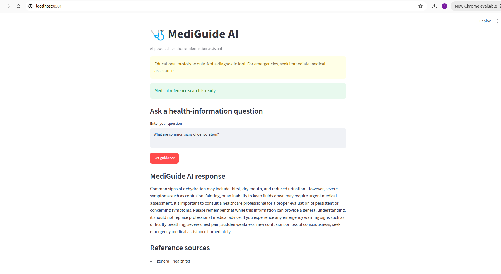

# MediGuide AI — Healthcare Guidance Assistant

## Overview
MediGuide AI is an educational healthcare guidance prototype that uses Retrieval-Augmented Generation (RAG) to answer general health-information questions from a small local reference collection.

## Features
- Document loading and text chunking
- Semantic retrieval using Sentence Transformers and ChromaDB
- Local language-model responses using Ollama and Mistral
- Emergency-keyword warning checks before generating an answer
- Specialist-category identification prototype
- Streamlit web interface
- Automated tests for core logic and safety behavior

## Architecture
1. Load reference documents from `data/medical_reference/`.
2. Split documents into overlapping text chunks.
3. Generate embeddings and store them in ChromaDB.
4. Retrieve relevant passages for a user's question.
5. Pass the question and retrieved context to the local language model.
6. Check configured emergency phrases before retrieval and generation.
7. Display the response and available source filenames in Streamlit.

## Tech Stack
Python, LangChain, Sentence Transformers, ChromaDB, Ollama, Mistral, Streamlit, and unittest.

## Setup
Create and activate a Python virtual environment, install the dependencies listed in `requirements.txt`, and ensure Ollama is installed and the required model has been downloaded.

Example on Linux:

```bash
python3 -m venv .venv
source .venv/bin/activate
pip install -r requirements.txt
ollama pull mistral
```

## Run
From the project root:

```bash
streamlit run app.py
```

## Run Tests

```bash
python -m unittest discover -v
```

## Limitations and Safety
This is a learning and portfolio prototype, not a clinically validated medical system. It does not diagnose conditions or replace a qualified healthcare professional. Emergency phrase matching is rule-based and may miss emergencies or flag hypothetical/negated phrases. The specialist lookup is not connected to a live provider directory and does not return verified doctors. Reference content requires appropriate review before any real-world clinical use.

## Demo

